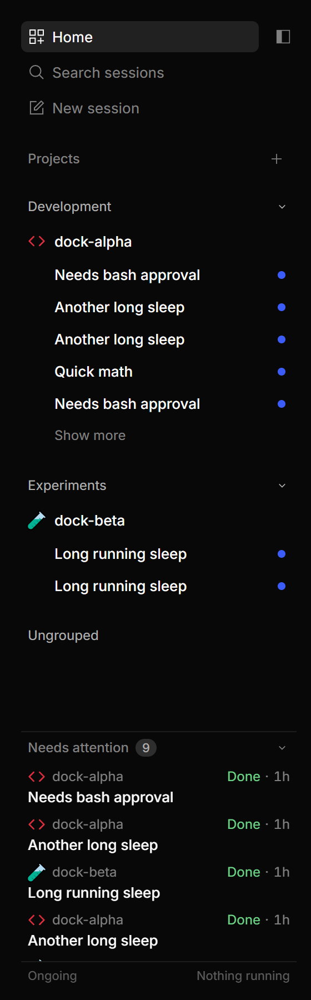
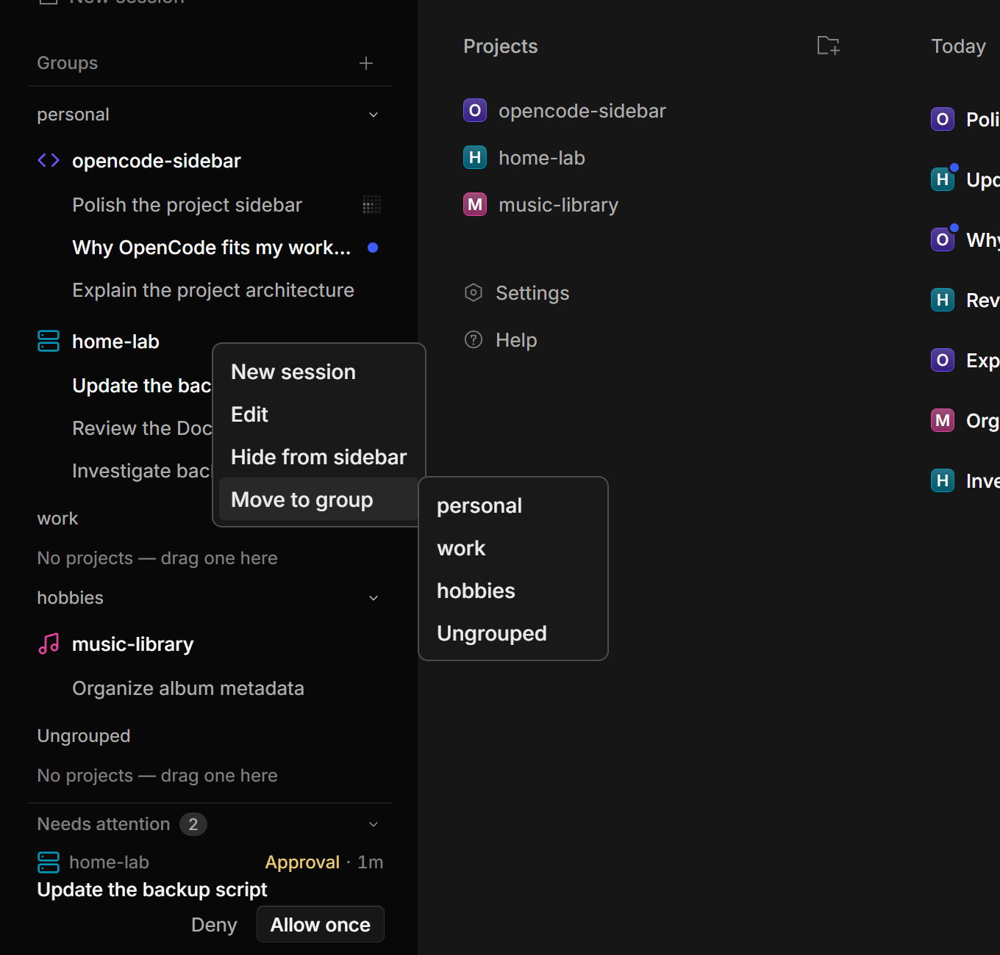
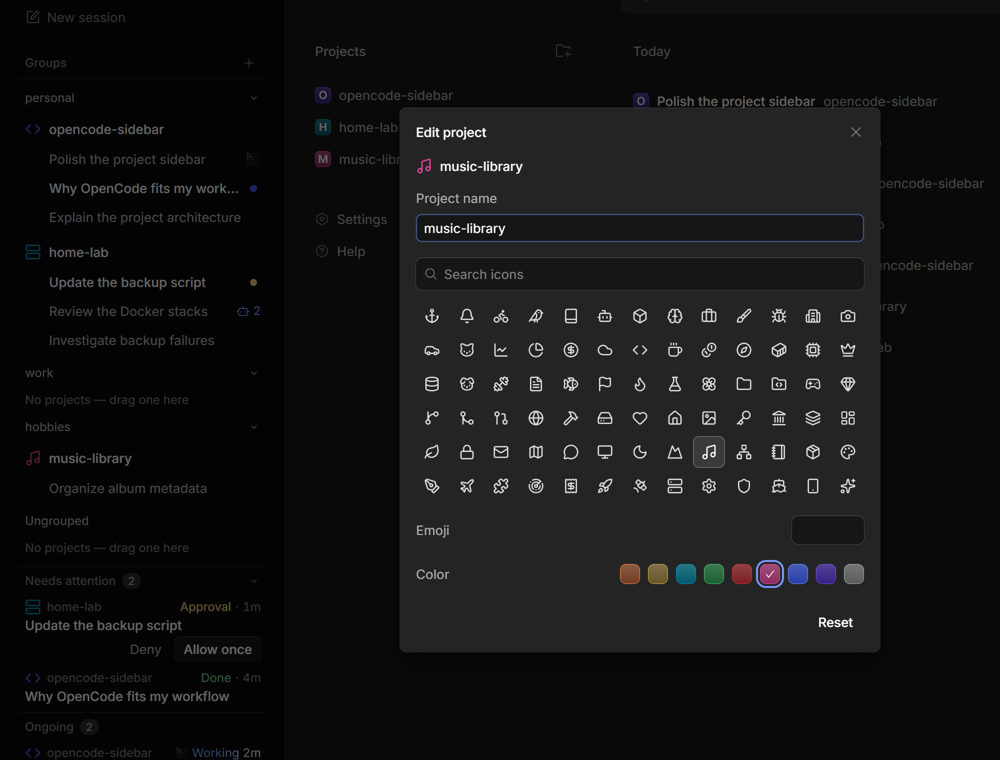

# OpenCode · Sidebar Pro

A maintained fork of [OpenCode](https://github.com/anomalyco/opencode) with the Sidebar Pro project sidebar,
inspired by Codex. Independent project; not built by or affiliated with the OpenCode team.



*Real web UI with demo projects, conversations and activity states. No private conversations are shown.*

## What's different

- **Project groups:** create, rename and reorder groups; drag projects within or between them.
- **Project icons:** choose a coloured monochrome icon or an emoji.
- **Project actions:** edit the display name, icon and colour; start a session with `+`, or hide a project from the sidebar
  and restore it from the toolbar's **… → Hidden projects** menu. Hiding never deletes its files or conversations.
- **Nested conversations and pins:** pinned conversations stay above the newest five unpinned sessions per project,
  with **Show more** for older sessions. Each set is ordered by its last update.
- **Archived conversations:** toggle **Archived** in the compact toolbar to browse and restore history by group
  and project. Empty groups disappear, older pages remain reachable, and the live Dock stays put.
- **Conversation actions:** Pin and Archive on hover/focus; right-click or **Shift+F10** for the full menu, including
  **Fork conversation**, **Copy conversation ID**, **Copy conversation reference** and **Mark as unread / Mark as read**.
  The same actions are available in the conversation header's **…** menu.
- **Conversation references:** copy the existing `@session:ses_…` mention format for another conversation on the same
  server, even in a different repository. Copying does not attach history or add an agent-side conversation-reading tool.
- **Unread reminders:** mark conversations unread locally without changing their activity status. Opening one clears its
  reminder; Mark as read also uses OpenCode's existing server-side viewed state.
- **Session moves:** drag a conversation to another project on the same server; running sessions offer queue or steer.
- **Bottom Dock:** collapsible **Needs attention** for approvals, questions, failures and unread results; permanent
  **Ongoing** with a blue text shimmer while sessions run and a compact placeholder when idle.
- **Resizable:** the Dock takes at most half the sidebar; lists scroll independently.
- **Navigation:** mouse Back/Forward uses the same history as the keyboard commands.

Enable it under **Settings → General → Interface mode → Sidebar Pro**. Other interface modes remain available.

### Organize your projects

Right-click a project to start a conversation, edit it, hide it, or move it to another group. Empty groups remain compact
drop targets. Hiding a project never deletes its files or conversations.



### Make it yours

Edit a project's display name, choose a monochrome glyph or emoji, and pick its colour in one popup.



## Data

Projects and conversations stay on your OpenCode server. Groups, project order, emoji/glyph choices and Dock preferences
are client-local: browser localStorage, or the desktop client's `drafts.sqlite` (`state` table, `sidebar-projects` key).
These layout preferences are not transferred automatically between browser and desktop.
Pins, manual unread reminders and the archive-view preference are also client-local. Manual unread reminders do not sync
to other clients. Archiving a conversation is server-side and reversible;
it preserves the local pin and never deletes files or stops a running agent. A conversation-level fork copies the
current history and opens it without sending a prompt.

## Branch and builds

[`sidebar-pro`](https://github.com/colthreepv/opencode/tree/sidebar-pro) is this fork's default branch,
currently based on upstream **v2.2.5**. The branch is intended to be rebased onto upstream releases.
Official OpenCode downloads do **not** include this sidebar.

Download the [latest Windows release](https://github.com/colthreepv/opencode/releases/latest) and read the
[fork changelog](CHANGELOG.md) for the changes in each release.

For the current Windows build workflow, install the official OpenCode V2 desktop app and Bun, then run from this checkout:

```powershell
bun install
& .\packages\desktop\script\fork-build.ps1 -Repo (Get-Location).Path
& '.\dist\desktop\app\OpenCode Dev.exe'
```

Keep the entire output directory, not just the exe. The helper builds optimized, packaged assets with a separate
**OpenCode Dev** identity and disabled updater. It bundles the installed official CLI and connects to the ordinary local
service. An existing service registration is discovered without replacing or restarting it; with no registration,
the bundled CLI may start a service. Client preferences are separate from the official desktop app.

The fork build helper is Windows-specific; other platforms have not been validated for this feature.

## Fork automation

- **Upstream compatibility:** a check every six hours watches stable **V2** releases, tries the sidebar branch on the new base
  in a disposable runner, and reports conflicts or check results in one issue per release. It never pushes a rebase
  or modifies the maintained branch. You can also run it manually from the Actions tab.
- **Windows builds:** the manual **Sidebar Pro Windows desktop** workflow downloads the official CLI for the declared base,
  builds the desktop on a standard Windows runner, and uploads a ZIP with checksums and a build manifest.
  Artifacts expire automatically after **three days**. Published release assets are retained separately; there is no automatic
  release publication or desktop installation.

To request a Windows package from the current maintained branch:

```sh
gh workflow run sidebar-windows.yml --repo colthreepv/opencode --ref sidebar-pro
```

Download the resulting artifact from the [Actions page](https://github.com/colthreepv/opencode/actions/workflows/sidebar-windows.yml),
verify the ZIP against `SHA256SUMS`, and extract the whole app directory before launching it.

### Apply a published Windows release

With PowerShell 7 and the GitHub CLI installed, run from this checkout:

```powershell
& .\packages\desktop\script\sidebar-update.ps1
# Or select an exact release:
& .\packages\desktop\script\sidebar-update.ps1 -Tag v2.2.5-sidebar.3
```

The updater downloads and verifies the package before asking permission to close only the fork normally. It installs to
`%LOCALAPPDATA%\Programs\ai.opencode.desktop.sidebar`, creates an **OpenCode Sidebar** Start-menu shortcut, and reopens it.
Existing installations are kept in a sibling `.previous-*` directory; directory-promotion failures restore the old install.
It never force-kills processes or operates the official app/service, and it leaves client preferences untouched.
If the fork cannot close normally, close it yourself and rerun. Launch failure after installation may require manually
restoring the retained previous directory.

Use `-PrepareOnly` to download, verify and stage without closing/installing, or `-PackageDirectory <folder>` for an
extracted Actions artifact containing the app ZIP, `SHA256SUMS` and `build-manifest.json`. Keep running this script from the
checkout when migrating a fork launched from `dist/desktop/app`, so its exact path is recognized.

The version contract lives in [`.github/sidebar/config.json`](.github/sidebar/config.json). Update `baseTag` only after
reviewing and accepting an upstream rebase. The inherited upstream workflows are disabled in this fork; newly introduced
upstream workflows must be reviewed before enabling them.

The upstream watcher runs at approximately **00:17, 06:17, 12:17 and 18:17 UTC** (GitHub schedules may be delayed or dropped).
A normal manual run
does nothing when the latest stable V2 release is not newer than the base, or this fork commit was already checked.
To force a compatibility probe, including against the current base:

```sh
gh workflow run sidebar-upstream.yml --repo colthreepv/opencode --ref sidebar-pro -f release_tag=v2.2.5
```

Candidate code runs in a read-only job; a separate reporting job can update issues. A green report is a compatibility
signal, not an automatic rebase approval or a substitute for a desktop interaction test.

See the [implementation and rebase notes](packages/app/src/shell/sidebar-pro/PLAN.md) for maintenance details,
and the [upstream README](README.upstream.md) and [contributing guide](CONTRIBUTING.md) for the base project.
